# Title page

**Cross Platform Reverse Shell Assessment with AI Session Outcome Analysis**
Revision 2.0 - Revised FYP proposal. Prepared 22 October 2026.
Team, university, department, degree, supervisor and academic session: not supplied.

# Declaration and report status

This report revises the existing ERS final-year-project report around the agreed single AI feature: session-outcome analysis. The Linux and Windows reverse-shell framework remains the existing experimental foundation. A proposed read-only assistant classifies the observed outcomes of predeclared harmless laboratory tasks; it does not select or execute commands or improve evasion.

## Authorship and approval

Students must distinguish reused framework code from their own dataset, classifier, evaluation and reporting work. This document is a design and methodology revision, not a signed declaration of authorship, institutional approval or completed experiments. Acknowledgements and real signatures must be completed before submission.

**Submission information**
| Field | Status |
| --- | --- |
| Project foundation | ERS Linux and ERS-W Windows |
| Department | Cyber Security, as stated in the original report |
| Academic session | 2025-2026 in the original; confirm before submission |
| Students / registration IDs / university | Not supplied |
| Supervisor / approval signatures | Not supplied; unsigned |
| Revision / prepared | 2.0 / 22 October 2026 |
## Document authority

This revision supersedes the original report's unsupported numerical stealth comparisons. Existing functionality is acknowledged at a high level; payload delivery, evasion and persistence procedures are not extended. New runtime analysis modules, training and experiments remain proposed. The institution's exact formatting template was not supplied.

# Abstract

ERS is an existing cross-platform reverse-shell assessment framework with Rust implementations for Linux and Windows and Python-based listeners. This project proposes a single AI enhancement: evidence-grounded session-outcome classification in controlled laboratories. The assistant analyzes sanitized operator-side observations to estimate whether a predeclared harmless task completed with full output, executed with incomplete output, failed, or remains inconclusive. The existing framework remains the experimental tool; the model has no command-execution or traffic-control authority.

The central problem is that connection establishment, endpoint execution and complete output delivery are different events. An interrupted session may provide insufficient evidence to infer the task outcome. The proposed method uses independently recorded endpoint outcomes as supervised targets and offline evaluation ground truth, while preventing those labels from entering the inference features. A bounded analytical pipeline normalizes observations, constructs task-linked windows, trains baseline classifiers and returns predictions with confidence and evidence references.

Evaluation compares explicit rules, majority prediction, logistic regression and gradient-boosted trees using session- and machine-group holdouts. Primary measures include per-class precision and recall, macro-F1, false-success conclusions, calibration, abstention coverage and analysis overhead. Additional tests address missing events, concurrent sessions, schema mismatches and interrupted evidence writes. Expected outputs are a labeled lab dataset, one integrated outcome classifier, a reproducible benchmark and evidence-linked reports. Novelty and usefulness are hypotheses to validate; the revision claims no trained-model results, undetectability, universal detection resistance or production certification.

## Keywords

Reverse shell; controlled adversary emulation; session-outcome classification; supervised learning; ground truth; incomplete observations; cross-platform evaluation.

## Core idea

Retain ERS as the laboratory assessment tool and add one read-only AI assistant that predicts outcomes from sanitized observations, with independent evidence used to verify its predictions.

# Table of contents

| Section | Page |
| --- | --- |
| Declaration and report status | i |
| Abstract | ii |
| List of figures tables and abbreviations | iv |
| 1. Introduction | 1 |
| 2. Proposed solution and scope | 3 |
| 3. Literature review | 4 |
| 4. Requirements engineering | 7 |
| 5. Architecture diagram | 8 |
| 6. Methodology and label definitions | 17 |
| 7. Technical design and integration | 21 |
| 8. Evaluation methodology | 23 |
| 9. Market value and feasibility | 25 |
| 10. Project plan and risk register | 26 |
| 11. Conclusion and future work | 27 |
| Appendix A Implementation handover | 28 |
| References | 29 |

# List of figures tables and abbreviations

| Figure | Title | Page |
| --- | --- | --- |
| 5.1 | Existing assessment foundation with a read-only AI layer | 8 |
| 5.2 | Context DFD for session-outcome analysis | 9 |
| 5.3 | Level 1 analysis pipeline | 10 |
| 5.4 | Level 2 outcome classification | 11 |
| 5.5 | Use cases for the outcome assistant | 12 |
| 5.6 | Misuse cases and controls | 13 |
| 5.7 | Post-session outcome analysis activity | 14 |
| 5.8 | Assessment interaction sequence | 15 |
| 5.9 | Evidence schema with isolated research labels | 16 |
| 6.1 | Supervised outcome training and held-out evaluation | 20 |
| 10.1 | Proposed twelve-week schedule | 26 |
| Table | Page |
| --- | --- |
| Submission information | i |
| Table 1.1 Objectives and evidence | 2 |
| Table 2.1 Scope boundaries | 3 |
| Table 3.1 Literature comparison | 5 |
| Table 3.2 Tool positioning based on official sources | 6 |
| Table 4.1 Functional requirements | 7 |
| Table 5.1 Use-case outcomes | 12 |
| Table 6.1 Outcome taxonomy | 17 |
| Table 6.2 Dataset design | 18 |
| Table 6.3 Proposed feature groups | 19 |
| Table 7.1 Existing versus proposed components | 21 |
| Table 7.2 Analysis reliability checks | 22 |
| Table 8.1 Metrics | 23 |
| Table 8.2 Results template not measured | 24 |
| Table 9.1 Positioning and validation | 25 |
| Table 10.1 Milestones | 26 |
AI: Artificial Intelligence; ERS: Evasive Reverse Shell; C2: Command and Control; WSS: WebSocket over TLS; DFD: Data Flow Diagram; ERD: Entity Relationship Diagram; FYP: Final Year Project; ML: Machine Learning; PK/FK: Primary/Foreign Key.

# 1. Introduction

## 1.1 Existing project

The repository contains ERS for Linux and ERS-W for Windows, primarily implemented in Rust, plus Python listeners and supporting automation [1]. The original framework establishes endpoint-to-operator sessions for authorized laboratory assessments. This report adds an observational research component rather than a new shell, delivery mechanism or autonomous operator.

## 1.2 Motivation

A listener can show that a connection exists without proving that a particular task ran or that all output arrived. Network interruption, incomplete records and ambiguous messages can produce unsupported success or failure conclusions. An assessment assistant is useful only if it improves interpretation beyond a well-designed rule baseline.

## 1.3 Current evidence

The student reports establishing a same-network reverse-shell session and capturing traffic on both endpoints. Those captures were not supplied for this revision and the experiment was not reproduced. This is a user-reported feasibility observation, not independently validated model performance or general stealth evidence.

## 1.4 Research question

Can a trained classifier infer controlled remote-assessment task outcomes from incomplete operator-side observations more accurately than explicit rules, while generalizing across held-out machines and Linux/Windows environments?

## 1.5 Single-feature boundary

The only proposed AI feature is outcome classification. Failure root-cause diagnosis, attack planning, payload generation, autonomous command selection, stealth optimization and cleanup prediction are excluded from the initial AI implementation.

# 1. Problem statement and objectives

## 1.6 Problem statement

The framework's visible connection state and text output are not an independent record of endpoint execution. A task may execute while its response is lost, partially delivered or missing from the capture. Conversely, no visible output does not prove execution failure. The project needs a repeatable way to compare predicted outcomes with separately observed ground truth.

**Table 1.1 Objectives and evidence**
| ID | Objective | Required evidence |
| --- | --- | --- |
| O1 | Retain the existing experimental framework | Baseline provenance and scoped synthetic-lab runs |
| O2 | Define one outcome taxonomy | Documented labels, boundaries and ambiguous cases |
| O3 | Train our own outcome classifier | Versioned data, training configuration and model |
| O4 | Verify predictions independently | Separate endpoint records and label-review provenance |
| O5 | Compare fairly against rules | Held-out groups, per-class scores and false-success rate |
| O6 | Provide reproducible handover | Contracts, source mapping, milestones and checks |
## 1.7 Expected contribution

The candidate contribution is a cross-platform laboratory benchmark and evaluated outcome-classification assistant under incomplete observations. A new reverse shell or the presence of AI alone is not claimed as novelty. The exact gap needs a broader related-work review and measured evidence.

# 2. Proposed solution and scope

## 2.1 Proposed workflow

After an authorized synthetic run, import sanitized listener observations into a separate analysis pipeline. Correlate them with lab-issued session and task identifiers, construct bounded task windows, apply a trained classifier and produce a structured outcome prediction. Offline evaluation joins frozen predictions to independent endpoint records.

## 2.2 Smallest useful implementation

Begin with offline post-session analysis. It minimizes coupling to the shell and makes datasets, labels and comparisons auditable. A later read-only listener dashboard may display completed predictions, but the model never sends instructions back to the agent or changes session behavior.

**Table 2.1 Scope boundaries**
| Included | Excluded from the proposed AI feature |
| --- | --- |
| Outcome prediction and abstention | Command selection or execution |
| Sanitized task/session observations | Raw command text, credentials and sensitive output |
| Synthetic endpoint truth for evaluation | Oracle labels as live model input |
| Rules and student-trained models | Unrestricted LLM-generated operational actions |
| Repeated authorized lab experiments | External targets or unauthorized deployment |
## 2.3 Value to the two subjects

Penetration Testing contributes scoped adversary-emulation experiments, task verification and evidence reporting. Artificial Intelligence contributes labeled data, feature design, supervised training, uncertainty handling and generalization evaluation. The classifier supports assessment interpretation; it does not make the framework harder to detect.

# 3. Literature review

## 3.1 Review approach

This is a focused narrative review checked on 22 October 2026, not an exhaustive systematic review. Sources include primary paper records, conference pages, official tool documentation and the source repository. Searches covered AI-assisted penetration testing, log analysis, session evidence and encrypted-traffic evaluation. Publication types and limits are stated in the references.

## 3.2 AI-assisted assessment

PentestGPT [2] studies LLM-assisted penetration testing and assessment context. AutoPentester [3] studies iterative tool-driven automation. These establish that AI integration and automated assessment are prior work. The proposed classifier has a narrower target: task outcome interpretation without planning or execution authority.

## 3.3 Log anomaly detection and diagnosis

LogBERT [4] learns normal log-sequence behavior and detects anomalies. An anomaly is not equivalent to execution failure or incomplete output. LogRCA [5] identifies candidate root-cause evidence from distributed-service logs. It establishes diagnostic learning as prior work, but the proposed project intentionally limits its output to outcome classes rather than causal explanations.

## 3.4 Evaluation quality

A recent encrypted-C2 measurement study [6] highlights leakage and ground-truth problems that can inflate performance claims. Its task is traffic detection rather than execution-outcome classification, but the evaluation lesson applies: independent grouping, label provenance and training-only preprocessing are essential.

# 3. Research gap and contribution boundaries

**Table 3.1 Literature comparison**
| Work | Established focus | Proposed task distinction |
| --- | --- | --- |
| PentestGPT [2] | LLM assessment assistance | Outcome classification from fixed observations |
| AutoPentester [3] | Iterative assessment automation | Read-only analysis without action selection |
| LogBERT [4] | Log-sequence anomaly detection | Task-specific outcome labels |
| LogRCA [5] | Failure/root-cause evidence | Outcome only; causation not claimed |
| C2 evaluation study [6] | Leakage-controlled detection measurement | Execution/output ground truth at task level |
## 3.5 Candidate gap

The reviewed sources do not by themselves establish an independently verified benchmark for classifying ERS task outcomes under incomplete operator observations across Linux and Windows. This is a candidate domain-specific contribution inferred from their stated objectives, not proof that no related benchmark exists.

## 3.6 Necessary follow-up review

Before claiming novelty, examine remote-administration task tracking, distributed execution semantics, missing-data classification, selective prediction and agent-evaluation benchmarks. Official tool task-tracking capabilities must also be considered; session management already exists in mature frameworks.

## 3.7 Falsifiability

If explicit rules are equally accurate, retain that result. If observables cannot distinguish outcomes, report the information limit and abstain. Do not manufacture ambiguous labels or weaken baselines to justify AI. The useful contribution may be the benchmark and negative findings rather than a superior model.

# 3. Existing tools comparison

**Table 3.2 Tool positioning based on official sources**
| Tool | Documented role | Relationship to this FYP |
| --- | --- | --- |
| Existing ERS / ERS-W [1] | Rust Linux/Windows agents with Python listeners | Experimental foundation; reviewed claims need verification |
| Sliver [7] | Cross-platform adversary-emulation framework | Relevant alternative foundation; no stealth ranking asserted |
| Metasploit sessions [8] | Session details, history and session operations | Shows that session management is existing functionality |
| Cobalt Strike [9] | Adversary simulation; documented task/output tracking | Task correlation itself cannot be claimed as new |
| Proposed ERS outcome assistant | One trained outcome classifier and independent evaluation | Value depends on measured benefit over explicit rules |
## 3.8 Comparison limits

This is a scope comparison, not a head-to-head performance benchmark. No tool was executed for this report and no price, stealth percentage, detection ranking or universal feature-absence claim is asserted. Public descriptions do not establish the absence of an independently verified outcome benchmark.

## 3.9 Positioning

The FYP should compete on clarity of task definition, label quality, reproducibility and honest uncertainty, not unsupported claims that it is more evasive than commercial or open-source tools.

# 4. Requirements engineering

**Table 4.1 Functional requirements**
| ID | Requirement | Acceptance evidence |
| --- | --- | --- |
| FR01 | Import only scoped synthetic-run records | Manifest and schema rejection tests |
| FR02 | Normalize and sanitize before storage | Secret-canary and field-allowlist checks |
| FR03 | Keep tasks and sessions correctly separated | Interleaved-record fixtures |
| FR04 | Predict one outcome with confidence/status | Contract and known-fixture checks |
| FR05 | Abstain on inadequate observations | Incomplete/corrupt input fixtures |
| FR06 | Keep oracle labels inaccessible to inference | Feature and access-boundary audit |
| FR07 | Export evidence-linked predictions | Valid IDs, model version and provenance |
| FR08 | Reproduce training and evaluation | Frozen data/split/model manifests |
## 4.1 Stakeholders

The operator performs approved lab assessments. The researcher builds datasets and models. A supervisor approves scope and methodology. An examiner reviews reproducibility and original contributions. The inference service is an observer, not an additional operator.

## 4.2 Quality requirements

Bound input size and analysis resources; reject unknown fields and schema versions; record missing observations; protect redacted evidence; use immutable snapshots; recover committed analysis records after interruption; and make model unavailability explicit. Do not change the agent or transport to improve connectivity or stealth as part of this research feature.

# 5. Architecture diagram

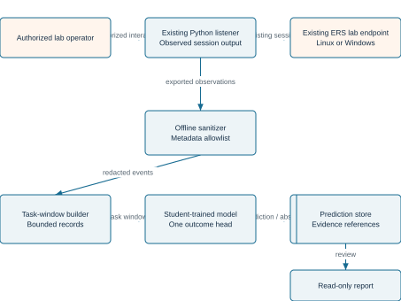

## 5.1 Architectural separation

The upper path represents the existing framework at a high level. The lower path is the proposed research analysis pipeline. No reverse edge connects the AI to task execution. Offline analysis is the initial implementation; it requires no model running on the lab endpoint.

## 5.2 Independent truth

A separately administered endpoint recorder verifies harmless task completion and expected output. Its labels are visible to the dataset curator and evaluator only. They never enter the live inference feature set.

# 5. Context DFD

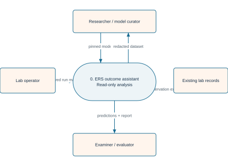

## 5.3 Data-flow conventions

The context process is 0; Level 1 contains 1.0-5.0; Level 2 decomposes prediction process 4.0. Rounded shapes are processes, tinted boxes are external entities and marked rectangles are stores. Arrows carry data, not instructions to the agent.

The operator supplies approved run context. Existing laboratory records supply observations. The researcher supplies a trusted model and receives redacted data. The examiner/evaluator receives predictions for comparison with separately held endpoint truth.

# 5. DFD Level 1

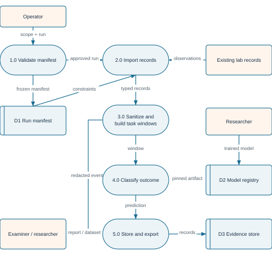

## 5.4 Boundary consistency

These preserve the context inputs and outputs. Independent endpoint labels are excluded from this inference diagram and joined later by the research evaluator. Import validation rejects files outside the approved synthetic-run manifest.

# 5. DFD Level 2

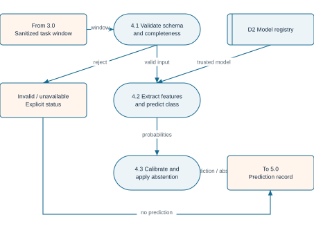

## 5.5 Prediction is not verification

The model returns a predicted outcome, confidence, evidence IDs and analysis status. The evaluator later records whether this matches independent endpoint truth. A high confidence score cannot establish that execution occurred.

Unknown schema, missing model and corrupt input receive explicit non-prediction statuses. A disconnected or empty window is not automatically labeled as execution failure.

# 5. Use case diagram

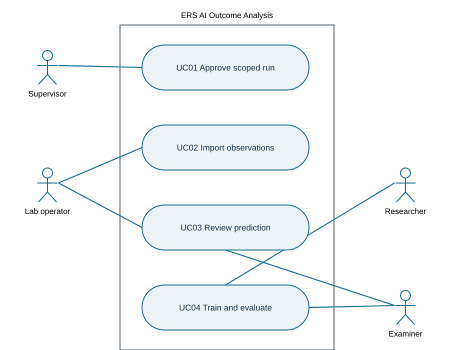

**Table 5.1 Use-case outcomes**
| Case | Precondition | Result |
| --- | --- | --- |
| UC01 | Lab approval and manifest | Frozen scope or rejection |
| UC02 | Approved synthetic records | Redacted windows or invalid-input status |
| UC03 | Stored prediction/evidence | Human review, not automatic execution |
| UC04 | Dataset, oracle and grouped splits | Model and measured evaluation |
All uses are analysis and research functions. Operator actions in the original framework remain outside AI authority.

# 5. Misuse case diagram

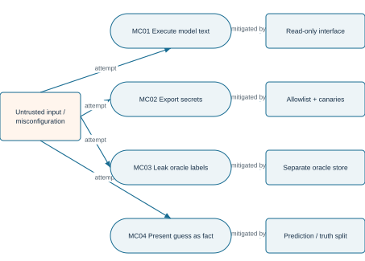

## 5.6 Misuse acceptance checks

Reject arbitrary command fields in prediction requests. Scan synthetic secret canaries before storage and export. Audit that inference cannot access endpoint truth. Display predictions, confidence and independent verification as distinct fields. The assistant never sends generated text to a listener or endpoint.

# 5. Activity and sequence diagrams

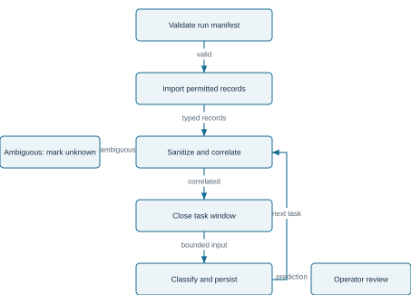

## 5.7 Processing order

Import, sanitize, correlate, predict and persist without modifying the original assessment. Do not combine tasks based only on similar timestamps. Ambiguous records remain explicitly unassigned or inconclusive. Figure 5.8 on the next page details the analysis interactions.

# 5. Analysis sequence

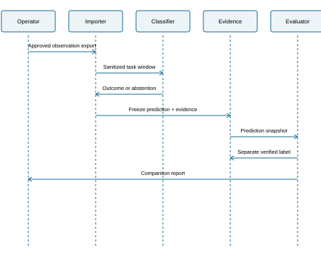
## 5.8 Independent evaluation

The model sees only the sanitized operator-observation window. Predictions are frozen before an evaluator joins endpoint truth. Offline joins use lab-issued identifiers and reviewed provenance; the join is not a runtime model dependency.

If the analysis service is unavailable, the importer records UNAVAILABLE and can be rerun later. No reconnect, execution retry or agent change is triggered by the assistant.

# 5. Data model and deployment

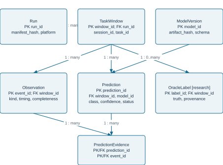

## 5.9 Storage and deployment

Deploy the initial assistant on the operator workstation as an offline tool or isolated local service. The model has no endpoint route, listener-control credentials or oracle access. Use a transactional redacted evidence store and a separately permissioned research-label store. Foreign keys protect evidence references.

# 6. Methodology and label definitions

## 6.1 Unit of analysis

One prediction concerns one predeclared harmless task within a laboratory session. The model is called a session-outcome assistant because it analyzes session observations, but the evaluated unit is the task episode. A connection may contain multiple tasks; do not infer that all succeeded from one successful task.

**Table 6.1 Outcome taxonomy**
| Class | Independent definition |
| --- | --- |
| EXECUTION_COMPLETE | Endpoint completion and expected full output receipt independently verified |
| OUTPUT_INCOMPLETE | Endpoint execution verified; expected output receipt demonstrably partial or absent |
| EXECUTION_FAILED | Trusted fixture records explicit execution failure; not merely missing output |
| INCONCLUSIVE | Available independent records do not establish one of the other outcomes |
Prediction status is separate: PREDICTED, ABSTAINED, UNAVAILABLE or INVALID_INPUT. INCONCLUSIVE describes the label; ABSTAINED describes a model decision to withhold a prediction.

## 6.2 Label authority

The endpoint recorder and synthetic fixture define actual completion and expected output properties. A missing listener response alone cannot label failure. A partial endpoint recorder cannot establish a complete negative; mark the case inconclusive. Keep labeling criteria fixed and version corrections.

# 6. Dataset and experimental conditions

## 6.3 Controlled collection

Use isolated Linux and Windows virtual machines, synthetic identities and preapproved harmless fixtures with known expected results. Collect normal completion, incomplete observations, explicit fixture failure and ambiguous cases. Record both actual outcome and observation availability separately.

**Table 6.2 Dataset design**
| Dimension | Plan | Control |
| --- | --- | --- |
| Platforms | Linux and Windows lab VMs | Record exact image and software versions |
| Grouping | Run, machine, session, task and capture period | Keep related records in one split |
| Conditions | Normal and controlled interrupted observations | No evasion optimization or autonomous reactions |
| Pilot size | Estimate after initial collection | Do not claim a fixed count guarantees power |
| Truth review | Independent recorder plus reviewed sample | Preserve disagreements and unknowns |
## 6.4 Data minimization

Export normalized metadata only. Exclude command strings, credentials, environment dumps, file contents and raw output. Optional size, timing, event-count and completeness summaries must be derived without saving sensitive values. Do not hash secret content as an identity shortcut.

## 6.5 Observability limit

If two true outcomes produce identical allowed observations, no classifier can reliably distinguish those cases from those inputs alone. Report that limitation, evaluate abstention and avoid claiming that a model reconstructs hidden execution with certainty.

# 6. Features and student training

**Table 6.3 Proposed feature groups**
| Group | Examples | Constraint |
| --- | --- | --- |
| Observed sequence | Connection seen; output chunk seen; close event | No synthetic oracle completion event |
| Timing | Relative intervals; observation duration | No future records; bound values |
| Completeness | Missing-log flag; chunk count; truncation flag | Flag source must be an allowed observation |
| Output metadata | Size bucket and observed terminal marker availability | No raw output or fixture-answer fingerprints |
| Identifiers | Opaque run/session/task/window IDs | Grouping only, never predictive inputs |
## 6.6 Baselines and models

Implement explicit rules and a majority baseline before training. Fit logistic regression and gradient-boosted trees on the same allowed window features. The students train and version the selected model. A large language model or external API is not required. A sequence model is optional future work, not part of the initial single-feature commitment.

## 6.7 Selection and calibration

Fit preprocessing on training groups only. Tune hyperparameters, class weighting, confidence calibration and abstention thresholds on validation groups only. Freeze the final artifact before testing. Rules must receive the same informative observations as the model; do not deliberately weaken them.

# 6. Training pipeline

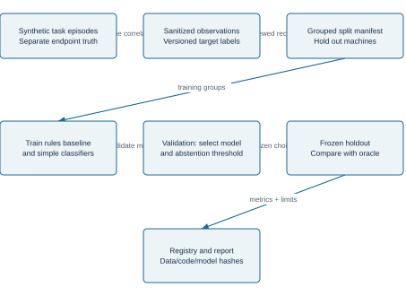

## 6.8 Split protocol

All tasks from one session and all near-duplicate fixture runs belong to the same split. Hold out machines and collection periods. Report Linux and Windows separately. Cross-OS transfer is an additional experiment and must not be implied by a mixed-platform random split.

When choosing model designs after inspecting test folds, obtain a new untouched holdout for a final claim. Dataset size, prevalence and exclusions must be reported at the independent episode/group level.

# 7. Technical design and integration

**Table 7.1 Existing versus proposed components**
| Component | Existing foundation | Proposed analytical work |
| --- | --- | --- |
| ERS/src/main.rs | Linux Rust agent | No new execution/evasion behavior in this feature |
| ERS-W/src/main.rs | Windows Rust agent | No new payload or persistence behavior |
| ERS/listener.py and ERS-W/listener.py | Operator-side session interfaces | Use permitted exported records; inspect actual schemas |
| analysis/ | Not established as existing | Importer, sanitizer, windows, prediction and reporting |
| ml/ and evaluation/ | Proposed | Training, split audit and metric calculation |
| lab/ | Proposed research fixtures | Independent truth and resettable benign scenarios |
## 7.1 Integration approach

Start as post-session analysis of exported records; do not rewrite agent transport or dispatch. Inspect the actual pinned checkout before relying on existing log fields. If records do not support task correlation, record that as a feasibility limitation instead of fabricating certainty.

## 7.2 Input/output contract

Input: schema version, opaque run/session/task/window identifiers, ordered sanitized observations and completeness flags. Output: model version, predicted class, calibrated confidence or null, analysis status, abstention reason and evidence event IDs. Reject arbitrary instructions and unknown fields.

# 7. Reliability and privacy of the assistant

**Table 7.2 Analysis reliability checks**
| Concern | Required behavior | Test evidence |
| --- | --- | --- |
| Resource limits | Bound input, window length and workers | Oversized import and saturation fixtures |
| Correlation | Never join different tasks silently | Interleaved and duplicate-ID fixtures |
| Privacy | Allowlist before persistence | Seeded-secret scan |
| Model outage | UNAVAILABLE without agent changes | Unavailable-service fixture |
| Storage | Recover committed redacted records | Interrupted-write recovery |
| Evidence integrity | Every reference exists and matches task | Foreign-key and report checks |
| Oracle leakage | No truth access during inference | Access and feature audit |
## 7.3 Proposed engineering targets

The first acceptance target is zero seeded-secret leakage and zero cross-task evidence joins in defined negative tests. A provisional local p95 analysis target is 250 ms per closed window on disclosed hardware. Freeze final bounds after the pilot; these are design targets, not achieved results.

Offline analysis must not affect agent or listener availability. Protect synthetic records with appropriate file permissions and retention. Model errors must remain visible. Reprocessing creates a new model-versioned prediction rather than overwriting historical truth.

# 8. Evaluation methodology

## 8.1 Main comparisons

Compare explicit rules, majority prediction, logistic regression and gradient-boosted trees on identical independent test episodes. Freeze the observation format and label taxonomy. Evaluate complete observations and missing-observation subsets separately. An ambiguous case is not evidence that the model is defective if the required information is absent; its uncertainty behavior must be measured.

**Table 8.1 Metrics**
| Measure | Definition / purpose |
| --- | --- |
| Per-class precision and recall | Evaluate every outcome class separately |
| Macro-F1 | Summarize performance without majority dominance |
| False-success rate | Incorrect EXECUTION_COMPLETE predictions among non-complete episodes |
| False-discovery among success claims | Incorrect complete predictions / all complete predictions |
| Risk versus coverage | Error among accepted predictions versus abstention rate |
| Calibration | Check whether confidence reflects observed correctness |
| Analysis overhead | Latency, CPU/RAM and record-processing throughput |
## 8.2 Statistical analysis

Use paired comparisons and confidence intervals resampling independent sessions or scenario groups, not individual correlated events. Determine sample size from pilot variability. Report missing data, unknown labels, failed runs and predeclared exclusions. Do not claim universal accuracy from a small same-network demonstration.

# 8. Planned results and limitations

**Table 8.2 Results template not measured**
| Approach | Macro-F1 | False-success rate | Coverage |
| --- | --- | --- | --- |
| Explicit rules | Not measured | Not measured | Not measured |
| Majority baseline | Not measured | Not measured | Not measured |
| Logistic regression | Not measured | Not measured | Not measured |
| Gradient-boosted trees | Not measured | Not measured | Not measured |
## 8.3 Evidence status

No new model, dataset or outcome-classification evaluation was executed for this report revision. The earlier same-network experiment is user-reported and its captures were not reviewed here. Original stealth percentages and comparative rankings lack reproduced supporting evidence and are not adopted as results.

## 8.4 Limitations

Synthetic tasks may not represent complex assessments. Limited machines constrain external validity. Labels can be wrong if the endpoint recorder fails. Platform-specific event patterns can create shortcuts. Explicit rules may match or outperform ML. Packet captures cannot establish hidden execution semantics alone.

## 8.5 Interpreting a negative result

If the model provides no improvement, report the benchmark and information limits. If it is overconfident under missing observations, document the failure. The objective is reliable assessment evidence, not an obligatory claim that AI outperforms every alternative.

# 9. Market value and feasibility

## 9.1 Intended value

Potential users include university security labs, penetration-testing instructors and internal assessment teams needing reproducible evidence review. The value hypothesis is fewer unsupported success claims, clearer student assessment and consistent Linux/Windows reporting. These benefits have not yet been validated with customers.

**Table 9.1 Positioning and validation**
| Aspect | Proposed position | How to validate |
| --- | --- | --- |
| Existing tools | Complement mature session interfaces | Review documented task tracking and avoid duplicate claims |
| Educational use | Visible predictions versus ground truth | Approved synthetic exercise and instructor review |
| Operational usefulness | Read-only post-session evidence assistant | Measure interpretation errors and review effort |
| Commercial readiness | Research prototype initially | No revenue, market size or certification assumed |
## 9.2 Resources and cost

A local CPU workstation and isolated Linux/Windows VMs are the initial plan. Small tabular models do not require an external LLM API or dedicated GPU. Record actual hardware, licensing, annotation time and compute cost. No unsupported product-pricing comparisons are included.

## 9.3 Practical scope

Deliver one reliable analytical feature before considering dashboards or natural-language explanations. The proposed tool is not positioned as a replacement for mature adversary-emulation frameworks.

# 10. Project plan and risk register

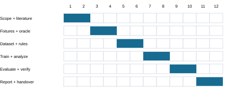
**Table 10.1 Milestones**
| Weeks | Deliverable | Exit criterion |
| --- | --- | --- |
| 1-2 | Scope, review and taxonomy | Supervisor-reviewed question and labels |
| 3-4 | Synthetic fixtures and oracle | Verified complete/failure/unknown examples |
| 5-6 | Sanitized dataset and rules | Correlation and split audit |
| 7-8 | Training and local analysis | Versioned classifier and explicit abstention |
| 9-10 | Held-out evaluation | Metrics, limitations and privacy checks |
| 11-12 | Report and handover | Rebuildable artifacts and documented demo |
## 10.1 Principal risks

The main risks are insufficient observable information, oracle mistakes, shortcut learning, cross-task joins, insufficient sample size and no improvement over rules. Mitigate with reviewed truth records, group splits, privacy allowlists and a pilot-first plan. Do not expand into new offensive capabilities to compensate for weak research results.

# 11. Conclusion and future work

## 11.1 Conclusion

The revised project keeps the existing ERS framework as an authorized laboratory assessment foundation and adds one student-trained outcome-classification assistant. The main research task is to distinguish supported task outcomes under incomplete observations while maintaining independent ground truth and honest uncertainty.

The expected FYP contributions are a documented taxonomy, redacted dataset, baseline models, one integrated classifier and reproducible evaluation. The study does not claim a new reverse-shell concept, validated stealth superiority, global novelty or completed model performance.

## 11.2 Future work after the initial feature

- Extend the benchmark to additional independent lab machines and capture periods.
- Investigate small sequence models if event ordering adds measured value.
- Study transfer between Linux and Windows without platform-identity shortcuts.
- Improve uncertainty calibration and explicitly characterize observational equivalence.
- Add evidence-constrained natural-language summaries as a presentation layer.
- Evaluate read-only analyst usability under institutional approval.
## 11.3 Final claim criteria

A novelty claim requires a broader literature comparison and a clearly differentiated result or artifact. A usefulness claim requires fair comparisons with strong rules. A robustness claim applies only to measured analysis conditions. The original framework and proposed assistant must remain distinguishable in the final demonstration.

# Appendix A Implementation handover

## A.1 Scope for another developer or AI

Implement session-outcome analysis only. Keep ERS and ERS-W as the existing experimental foundation. Do not substitute PhantomGate, authentication-flow diagnosis, autonomous next-test selection, stealth optimization or payload generation. Begin with offline records, explicit rules and independently verified synthetic fixtures.

## A.2 First implementation increments

- Inspect the actual checkout, repository instructions and available supported tests; record the baseline commit.
- Define allowed observation fields and one task-window schema; validate before persistence.
- Create independently labeled harmless lab episodes and a correlation/label-review procedure.
- Implement a rules baseline and an evidence-linked report before model training.
- Train simple classifiers on frozen groups and evaluate against the same rules.
- Integrate the selected read-only model and record actual validation evidence.
## A.3 Definition of done

One complete end-to-end dataset/training/evaluation run with independent labels; no forbidden fields in exports; no cross-task joins; explicit abstention and unavailable statuses; reproducible splits and model provenance; per-class results and false-success analysis; source/PDF consistency. This is an acceptance checklist, not a statement of completed implementation.

## A.4 Before academic submission

Confirm the university template and academic session; complete names and signatures; add actual acknowledgements; identify student contributions and assistance; replace planned results with measured evidence; verify all sources and inspect the rendered PDF.

# References

[1] Un-9oon/stealth-reverse-shell. Existing ERS and ERS-W framework and original FYP report. Baseline commit 20e0518de1bb31a866212e73b1882c4db5514772. Software artifact.https://github.com/Un-9oon/stealth-reverse-shell/tree/20e0518de1bb31a866212e73b1882c4db5514772

[2] G. Deng et al. PentestGPT: Evaluating and Harnessing Large Language Models for Automated Penetration Testing. USENIX Security, pp. 847-864, 2024.https://www.usenix.org/conference/usenixsecurity24/presentation/deng

[3] Y. Ginige, A. Niroshan, S. Jain, and S. Seneviratne. AutoPentester: An LLM Agent-based Framework for Automated Pentesting. arXiv:2510.05605, 2025; author record lists IEEE TrustCom 2025.https://arxiv.org/abs/2510.05605

[4] H. Guo, S. Yuan, and X. Wu. LogBERT: Log Anomaly Detection via BERT. arXiv:2103.04475, 2021. Author manuscript.https://arxiv.org/abs/2103.04475

[5] T. Wittkopp, P. Wiesner, and O. Kao. LogRCA: Log-based Root Cause Analysis for Distributed Services. arXiv:2405.13599, 2024; author record lists Euro-Par 2024 acceptance.https://arxiv.org/abs/2405.13599

Sources checked on 22 October 2026. The literature review is focused and does not establish global uniqueness.

# References continued

[6] H.-H. Nguyen-Huu, V.-T. Phan, and K. Nguyen-An. Multi-View Fusion for Encrypted C2 Detection: A Leakage-Controlled Measurement Study of Evaluation Pitfalls. arXiv:2609.27311, 2026. Author manuscript.https://arxiv.org/abs/2609.27311

[7] Bishop Fox. Sliver adversary-emulation framework. Official software repository.https://github.com/BishopFox/sliver

[8] Rapid7. Manage Your Meterpreter Session. Official Metasploit documentation.https://docs.rapid7.com/metasploit/manage-meterpreter-and-shell-sessions/

[9] Fortra. Cobalt Strike Features. Official product documentation. Tool capabilities are descriptions, not independent comparative results.https://www.cobaltstrike.com/product/features

[10] K. Scarfone, M. Souppaya, A. Cody, and A. Orebaugh. Technical Guide to Information Security Testing and Assessment. NIST SP 800-115, 2008. Guidance.https://nvlpubs.nist.gov/nistpubs/Legacy/SP/nistspecialpublication800-115.pdf

## Assessment governance

NIST SP 800-115 [10] informs scope, authorization, evidence analysis and reporting. It does not certify this project. Use only approved laboratory assets and document the actual observation and labeling boundaries.
